<picture>
  <source media="(prefers-color-scheme: dark)" srcset="assets/hero-dark.svg">
  <source media="(prefers-color-scheme: light)" srcset="assets/hero-light.svg">
  
</picture>

  
  

## 01 — About

Fullstack developer. I like the messy middle of building products: the API contract, the loading state, and the migration nobody wants to run.

- **Now** — building [SheetDesk](https://github.com/TranLoiIT/quan-ly-khach-hang-to-sheets), a CRM that runs on top of Google Sheets.
- **Shipped** — a movie platform (web + mobile + API) and wedding invitation sites for two real couples. The deadline for those was the wedding.
- **Care about** — clean architecture, fast feedback loops, and interfaces that explain themselves.
- **Open to** — interesting problems where the front end, the back end, and the deadline all matter.

## 02 — Stack

**Frontend**  
       

**Backend**  
    

**Mobile & tooling**  
     

## 03 — Selected work

### SheetDesk — a CRM that runs on a spreadsheet

`Next.js 16` · `React 19` · `TypeScript` · `Tailwind v4` · `shadcn/ui` · `Google Apps Script`

Small teams already live in Google Sheets. SheetDesk gives them a proper dashboard on top: JSON accounts, bcrypt-hashed passwords, signed cookie sessions, and a UI that doesn't feel like a spreadsheet.

**[Live demo](https://quan-ly-khach-hang-to-sheets.vercel.app)** &nbsp;·&nbsp; **[Source](https://github.com/TranLoiIT/quan-ly-khach-hang-to-sheets)**

### V-Flix — a movie platform, end to end

`React` · `Redux-Saga` · `React Native` · `Node.js` · `Express` · `MongoDB` · `Docker`

A movie review and discovery product built as three pieces that actually talk to each other: a React web client, a React Native app, and a REST API with JWT auth, Cloudinary uploads, email, and web push. Containerized with Docker and served through Nginx.

**[Web client](https://github.com/TranLoiIT/V-flix)** &nbsp;·&nbsp; **[API](https://github.com/TranLoiIT/api-Vflix)** &nbsp;·&nbsp; **[Mobile app](https://github.com/TranLoiIT/mobile-app-flix)**

### Wedding invitations — two deadlines that could not move

`Next.js` · `TypeScript` · `Tailwind CSS` · `Ant Design` · `Google Maps`

Two invitation sites for real weddings: animated, responsive, with the schedule, the map, and the details guests actually open the link for. Mobile-first by necessity.

**[Hồng Ngọc](https://github.com/TranLoiIT/thiep-cuoi-hong-ngoc)** &nbsp;·&nbsp; **[Vũ Hiền](https://github.com/TranLoiIT/thiep-cuoi-vu-hien)**

**Also in the drawer** — [ASM-WEB-APPS](https://github.com/TranLoiIT/ASM-WEB-APPS) (PHP) · [Project_IV_FE](https://github.com/TranLoiIT/Project_IV_FE) (Vue / Nuxt) · [Architectural_Design_Software](https://github.com/TranLoiIT/Architectural_Design_Software) (architecture notes).

## 04 — Numbers

  <picture>
    <source media="(prefers-color-scheme: dark)" srcset="https://github-profile-summary-cards.vercel.app/api/cards/profile-details?username=TranLoiIT&amp;theme=github_dark&amp;bg_color=00000000&amp;title_color=C6FF4A&amp;text_color=9BA3AF&amp;icon_color=C6FF4A&amp;border_color=242A31&amp;chart_color=C6FF4A&amp;name=GitHub%20activity">
    
  </picture>

  <picture>
    <source media="(prefers-color-scheme: dark)" srcset="https://github-profile-summary-cards.vercel.app/api/cards/stats?username=TranLoiIT&amp;theme=github_dark&amp;bg_color=00000000&amp;title_color=C6FF4A&amp;text_color=9BA3AF&amp;icon_color=C6FF4A&amp;border_color=242A31&amp;hide_logo=true">
    
  </picture>
  <picture>
    <source media="(prefers-color-scheme: dark)" srcset="https://github-profile-summary-cards.vercel.app/api/cards/most-commit-language?username=TranLoiIT&amp;theme=github_dark&amp;bg_color=00000000&amp;title_color=C6FF4A&amp;text_color=9BA3AF&amp;icon_color=C6FF4A&amp;border_color=242A31">
    
  </picture>

## 05 — Say hi

The fastest way to reach me is right here on GitHub. If you're building something and the deadline is real, my inbox is open.

  
  <!-- Add your email / LinkedIn / Facebook badge here -->

  “Make it work, make it right, make it fast.” — Kent Beck

